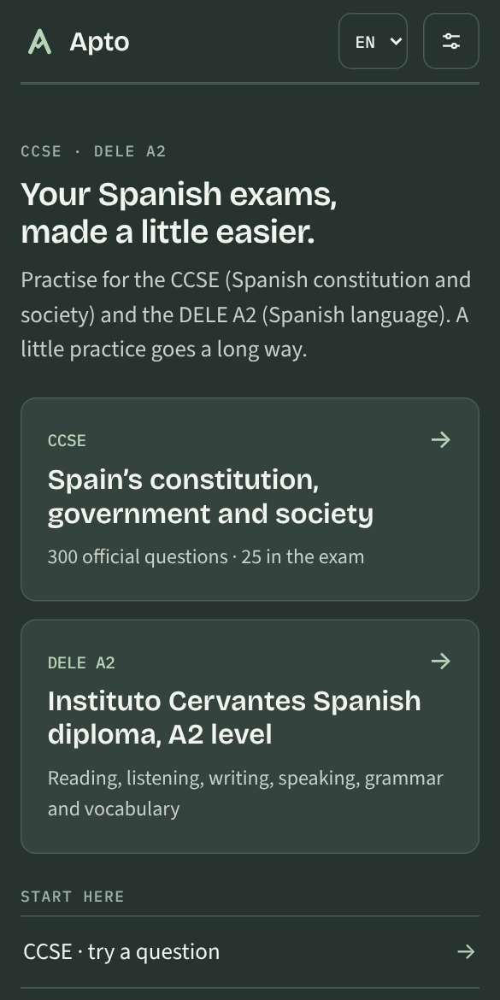
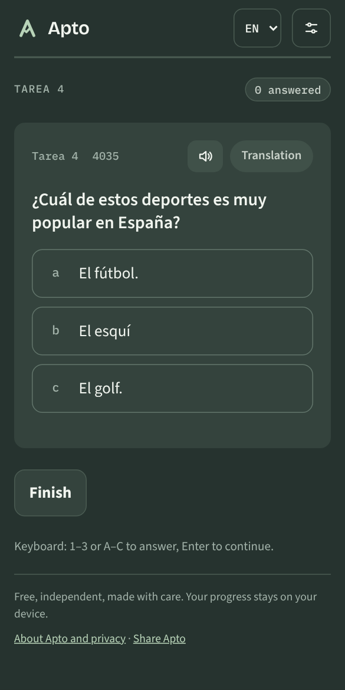
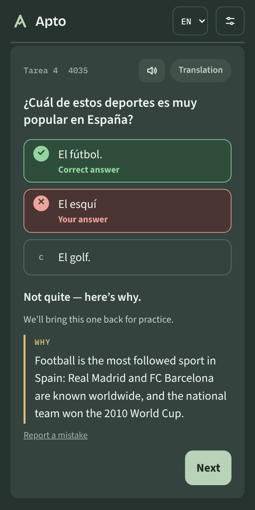
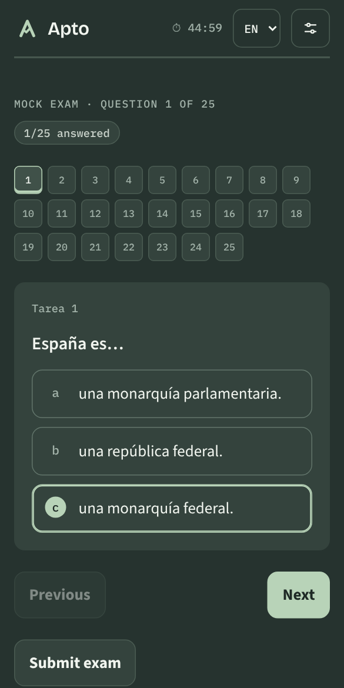

# Apto

Free, independent practice app for Spain’s **CCSE** (constitution and society) and **DELE A2** (Spanish language) exams.
Interface in Spanish, English, Russian and Ukrainian. Progress is stored only on the user’s device.
Not affiliated with the Instituto Cervantes.

**Live:** https://getapto.app/

<p>
  
  
  
  
</p>

## What’s inside

- **CCSE** — all 300 questions of the 2026 manual with the official answer key, translations (en/ru/uk),
  a short “why” explanation for every question, study by tarea, mistakes review, spaced repetition (1/3/7/16/35 days),
  25-question / 45-minute mock exam, progress report.
- **DELE A2** — four full reading + listening variants in the exam format (4 + 4 tasks, 25 + 25 items),
  vocabulary flashcards (9 topics incl. paperwork, 135 words, spaced repetition), 12 grammar topics,
  listening read by the device’s Spanish voices (with install help and a read-the-text fallback when there are none), grammar diagnostic with rule cards, writing practice with hints (accents, ¿¡, connectors, repetition), speaking practice with an in-browser voice recorder,
  full mock exam: reading (60 min) + listening (40) + writing (45) + speaking with recording, or reading + listening only, mistakes queue, progress by task.
- Study plan to the exam date, exam guide with official links, offline support (PWA), progress backup as a file or a text code,
  about & privacy page. No cookies, no analytics, no third-party requests (fonts are self-hosted).

## Develop

```bash
npm install
npx playwright install chromium   # once, for tests and icons
npm start                          # validate + build + serve at http://localhost:4173
npm test                           # validate + build + end-to-end checks
```

No framework and no runtime dependencies: `scripts/build.mjs` concatenates `src/js/*` (in the order from
`scripts/order.mjs`) into a hashed core bundle (code + the 300 CCSE questions) and two data packs loaded right after it:
`ccse.*.js` (translations, explanations) and `dele.*.js` (reading and listening texts). It writes `dist/` plus a service worker
that precaches everything for offline use.

## Project layout

```
src/index.html          page template
src/styles.css          all styles (light and dark themes)
src/js/                 app code and DELE content (classic scripts sharing globals)
src/data/               CCSE questions, translations, explanations (JSON)
public/                 manifest, icons, favicon.ico, link-preview image and fonts, copied as-is
scripts/                build, validate, serve, icons
tests/e2e.mjs           Playwright end-to-end checks on a phone viewport, incl. an axe-core accessibility audit
.github/workflows/      test + deploy to GitHub Pages on every push to main
```

## Content review pack

`node scripts/review-pack.mjs apto-review.pdf` builds a printable PDF of all original Spanish content (DELE tasks with answers, grammar, vocabulary, writing and speaking models, CCSE explanations) for a teacher or native speaker to check.

## Icons and link preview

Edit `public/icons/icon.svg`, then `npm run icons` regenerates the PNG icons, `favicon.ico` and `og-image.png`.

## Updating for a new year

1. Replace `src/data/ccse2026.json` with the new manual’s questions (same shape) and update translations/explanations.
2. Update dates and fees in `src/js/extras.js` (`GUIDE`).
3. `npm test`, then push to `main`.

## Content and licensing

Speaking task 2 photos are from [Unsplash](https://unsplash.com/?utm_source=apto&utm_medium=referral) under the [Unsplash License](https://unsplash.com/license). Each photo is credited under the image and on the About page; the list is in `public/photos/CREDITS.txt`:

- `parque.webp` — photo by [Ubaldo Bitumi](https://unsplash.com/@ubigraph?utm_source=apto&utm_medium=referral) on Unsplash
- `tienda.webp` — photo by [Richard Wang](https://unsplash.com/@rrricharddd?utm_source=apto&utm_medium=referral) on Unsplash
- `cafeteria.webp` — photo by [Shawn](https://unsplash.com/@shawnanggg?utm_source=apto&utm_medium=referral) on Unsplash
- `estacion.webp` — photo by [Hugh Stevenson](https://unsplash.com/@hughstevensonn?utm_source=apto&utm_medium=referral) on Unsplash
- `mercado.webp` — photo by [Alex Hudson](https://unsplash.com/@aliffhassan91?utm_source=apto&utm_medium=referral) on Unsplash
- `fiesta.webp` — photo by [Josh Frenette](https://unsplash.com/@joshfrenette?utm_source=apto&utm_medium=referral) on Unsplash


Code: MIT. Fonts (Bricolage Grotesque, Source Sans 3, IBM Plex Mono): SIL OFL 1.1, see `public/fonts/LICENSES.txt`. CCSE questions © Instituto Cervantes (Manual CCSE 2026), used for non-commercial practice with attribution.
All DELE texts, recordings scripts, explanations and translations are original to this project.
